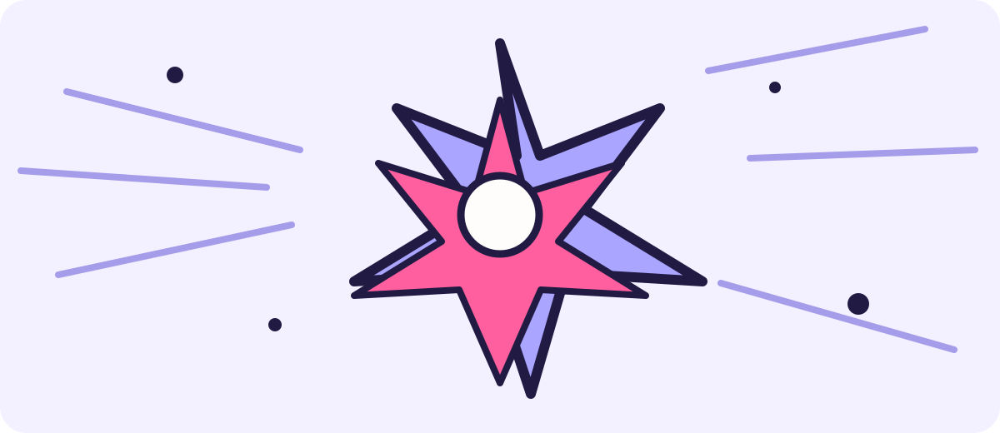

<p align="center"></p>

# ✨ VFX UI Anime

**Expressive motion for everyday interface components.** A dependency-free library of native Web Components built around tactile response, crisp visual feedback, and a distinctive visual identity.

<p align="center"></p>

## 🌸 The component library

Every component has its own folder with `index.js`, `demo.html`, and `README.md`.

| Component | Element | Component folder |
|---|---|---|
| Button | `<vfx-button>` | [components/button/](components/button/) |
| Toggle | `<vfx-toggle>` | [components/toggle/](components/toggle/) |
| Slider | `<vfx-slider>` | [components/slider/](components/slider/) |
| Checkbox | `<vfx-checkbox>` | [components/checkbox/](components/checkbox/) |
| Radio | `<vfx-radio>` | [components/radio/](components/radio/) |
| Input | `<vfx-input>` | [components/input/](components/input/) |
| Tabs | `<vfx-tabs>` | [components/tabs/](components/tabs/) |
| Progress | `<vfx-progress>` | [components/progress/](components/progress/) |
| Rating | `<vfx-rating>` | [components/rating/](components/rating/) |
| Toast | `<vfx-toast>` | [components/toast/](components/toast/) |
| Tooltip | `<vfx-tooltip>` | [components/tooltip/](components/tooltip/) |
| Like | `<vfx-like>` | [components/like/](components/like/) |
| Accordion | `<vfx-accordion>` | [components/accordion/](components/accordion/) |
| Segmented | `<vfx-segmented>` | [components/segmented/](components/segmented/) |
| Notification | `<vfx-notification>` | [components/notification/](components/notification/) |

## 🚀 Explore

Open the [interactive component gallery](index.html) or try any [standalone component demo](components/button/demo.html).

## 📦 Use a component

```html
<link rel="stylesheet" href="/styles.css">
<script defer src="/core.js"></script>
<script defer src="/components/button/index.js"></script>
<vfx-button>Continue</vfx-button>
```

Start with the component's local README and demo. See [the API overview](docs/COMPONENTS.md), [detailed API reference](docs/COMPONENT_API_REFERENCE.md), and [installation guide](docs/INSTALLATION.md).

## 🎨 Design language

Soft paper surfaces, deep ink typography, violet action color, pink accents, crisp borders, and concise motion cues. Override `--vfx-ink`, `--vfx-paper`, `--vfx-violet`, `--vfx-pink`, and related tokens to theme the controls.

## ♿ Accessibility and motion

- Prefer native browser semantics and keyboard interactions.
- Keep control labels descriptive and meaningful.
- The shared engine honours `prefers-reduced-motion`.
- Validate form behavior, focus states, and assistive-technology output in your target browsers.

## 🧰 Development

No package install is required to run the static gallery:

```bash
python3 -m http.server 8000
```

Run `npm run check` for static validation and `npm run test:browser` for the headless browser interaction suite.

## 📚 Documentation

- [Component overview](docs/COMPONENTS.md)
- [Component API reference](docs/COMPONENT_API_REFERENCE.md)
- [Installation](docs/INSTALLATION.md)
- [Architecture](docs/ARCHITECTURE.md)
- [Accessibility](docs/ACCESSIBILITY.md)
- [Testing](docs/TESTING.md)
- [Design system](docs/DESIGN_SYSTEM.md)
- [Changelog](CHANGELOG.md)

## License

See the root [MIT license](LICENSE). A separate third-party notice is retained for material present in earlier Git revisions.
