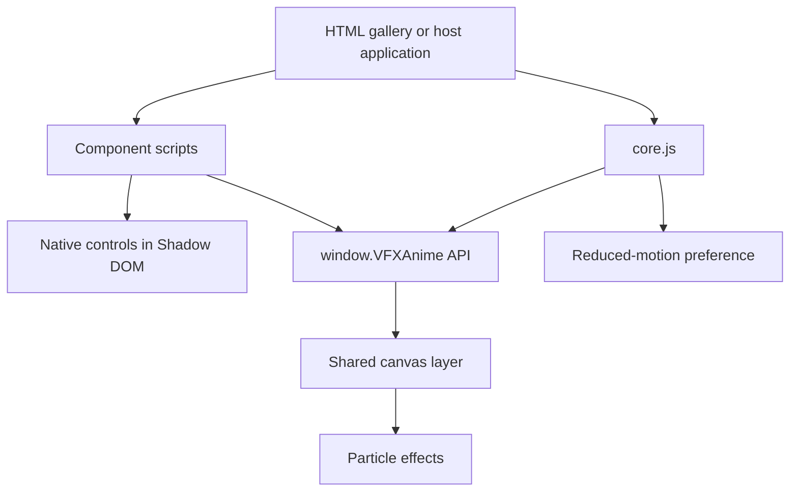

# 🏗️ Architecture

## Overview

VFX UI Anime is a static Web Components project. It has no runtime package dependencies, framework, bundler or server-side runtime.

## Runtime sequence

1. The host page loads `core.js`.
2. The core registers a shared `window.VFXAnime` API and a single fixed canvas.
3. Component scripts register custom elements with the browser.
4. Components render native controls in Shadow DOM.
5. User interactions update the native control and may call the shared effect API.
6. The animation loop clears and redraws active particles, then stops when there is no work.

## Design principles

- Native browser controls first, custom visuals second.
- No runtime dependencies.
- A single shared canvas rather than one canvas per control.
- Respect the operating-system reduced-motion preference.
- Keep components independently loadable after the shared core.
- Keep the gallery useful as a manual smoke-test surface.

## Boundaries

The shared canvas is a top-level overlay with a high stacking order. It ignores pointer input, but can visually overlap dialogs, sticky headers and other overlays. The current engine is intentionally small and does not yet expose a complete lifecycle API for third-party effect plugins.
