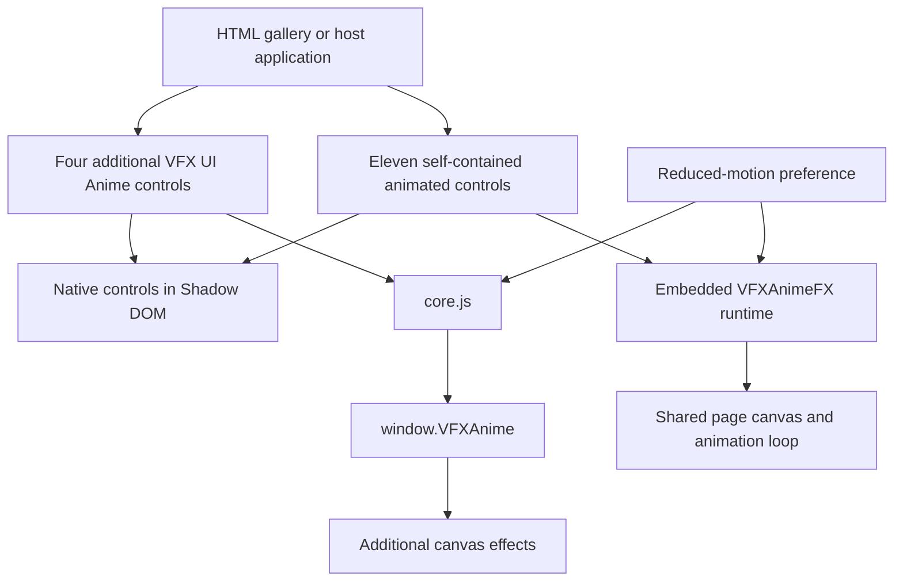

# 🏗️ Architecture

## Overview

VFX UI Anime is a static Web Components project. It has no runtime package dependencies, framework, bundler, or server-side runtime. It contains two groups of controls with separate, self-contained motion runtimes.

## Standalone animated controls

Button, Toggle, Slider, Checkbox, Radio, Input, Tabs, Progress, Rating, Toast, and Tooltip each carry the original motion engine and required artwork in their own component script. The first one loaded on a page initializes `window.VFXAnimeFX` and its page-wide effects canvas. Other source-backed components reuse that instance.

The Toggle contains its 43-frame painted animation in its own script. Sound-effect lettering, impact paths, particles, spring motion, and other drawing routines are embedded in the standalone files. No external sprite sheet, font asset, runtime CDN, or `core.js` request is required for these eleven controls.

## Additional VFX UI Anime controls

Like, Accordion, Segmented, and Notification use the separate `core.js` runtime. It exposes `window.VFXAnime` and a canvas for its additional particle feedback. Load `core.js` before these four component scripts.

The two runtimes have distinct globals and lifecycles. Do not rename one global to the other or assume the four additional controls use the standalone animation engine.

## Runtime sequence

1. The host page loads the standalone component scripts it needs.
2. The first standalone script creates `window.VFXAnimeFX`, its shared canvas, and its animation loop.
3. Each standalone script registers its own `vfx-*` custom element. Additional standalone scripts reuse the runtime already present.
4. If the page uses Like, Accordion, Segmented, or Notification, it loads `core.js` before those scripts. The additional controls use `window.VFXAnime`.
5. Each component renders its control in Shadow DOM and exposes the attributes, properties, and events listed in its README.
6. Reduced-motion preferences suppress or shorten decorative effects according to each component's implementation.

## Design principles

- Keep the eleven source-backed controls self-contained.
- Keep the four additional VFX controls independent of the source-backed runtime.
- Use native controls and keyboard behaviour where implemented.
- Keep decorative canvas layers pointer-transparent and hidden from assistive technology.
- Respect `prefers-reduced-motion`.
- Document actual attributes, properties, events, and limits instead of assuming a shared API.

## Boundaries

The effects canvas is a high-stacking-order overlay and may visually overlap dialogs, sticky headers, or other overlays. Effects behind individual controls may be clipped by ancestors with `overflow: hidden`. See the component READMEs for component-specific limitations.
