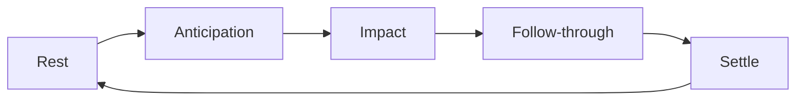

# 🎨 VFX UI Anime Design System

> **Phase 2 deliverable · Visual design foundations**  
> Status: design guidance for the VFX UI Anime gallery and additional controls. The eleven standalone animated controls retain their source-backed visual system and embedded artwork.

## 1. Design intent

VFX UI Anime should feel like a precise interface with the energy of a hand-drawn action frame. The interface must remain readable and usable first. Motion and decorative effects should amplify a meaningful interaction, not compete with the control.

**Brand promise:** expressive anime-inspired feedback, delivered through lightweight native web components.

### Core principles

1. **Control first.** The control's purpose, label, value, and state must remain clear before, during, and after an effect.
2. **Impact with restraint.** Use a focused visual accent for the important moment. Avoid making every interaction equally loud.
3. **Ink, paper, and accent.** Use the current deep-ink and warm-paper identity, with violet, lavender, and pink for purposeful emphasis.
4. **Plain at rest.** Idle controls should not animate continuously without a clear product reason.
5. **Source-backed motion language.** Preserve the embedded impact artwork, hand-drawn effects, and painted Toggle frames in the eleven licensed animated controls. Create original artwork for any newly authored controls, and keep all required third-party notices.
6. **Accessible by construction.** Preserve semantic controls, visible focus, readable contrast, and reduced-motion behavior.

## 2. Existing brand palette

The values below are taken from the current project brand mark, hero illustration, and page stylesheet. This phase formalizes their roles. It does not replace the live CSS declarations.

| Token | Existing value | Role | Usage |
|---|---|---|---|
| `--vfx-ink` | `#211B43` | Primary ink | Main text, outlines, strong borders, icon strokes |
| `--vfx-paper` | `#FFFDFB` | Warm paper | Main page background |
| `--vfx-lavender` | `#AAA5FF` | Soft impact | Shadows, inactive tracks, decorative depth |
| `--vfx-violet` | `#6557D9` | Primary accent | Links, active controls, selected states, emphasis |
| `--vfx-pink` | `#FF5F9E` | Impact accent | Short-lived emphasis, highlights, impact details |
| Surface tint | `#F3F0FF` | Lavender surface | Illustration and subtle section backgrounds |
| Border tint | `#E6E2F5` | Quiet border | Card boundaries and separators |
| Muted text | `#77718E` | Secondary text | Descriptions and supporting labels |

### Color rules

- Use ink on paper for default text and high-priority content.
- Use violet for links and interactive emphasis. Keep it distinguishable from ordinary text.
- Use pink as an accent, not as a default text color on white or warm paper.
- Lavender is suitable for filled decorative shapes and shadow tones. Do not use it as small text on a light surface.
- Prefer a small number of strong color roles over gradients on every component.
- Color must never be the only indicator of state. Pair it with text, shape, icon, or semantic state.

### Contrast checks

Contrast ratios below were calculated from the current hexadecimal palette using the WCAG relative-luminance formula. They are color-pair measurements, not a full accessibility certification.

| Foreground | Background | Ratio | Design decision |
|---|---|---:|---|
| Ink `#211B43` | Paper `#FFFDFB` | 15.89:1 | Excellent for all text sizes |
| Violet `#6557D9` | Paper `#FFFDFB` | 5.28:1 | Suitable for normal text |
| Muted `#77718E` | Paper `#FFFDFB` | 4.56:1 | Suitable for normal text, but do not lighten further |
| Violet `#6557D9` | Surface `#F3F0FF` | 4.78:1 | Suitable for normal text |
| White `#FFFFFF` | Violet `#6557D9` | 5.36:1 | Suitable for button labels |
| White `#FFFFFF` | Pink `#FF5F9E` | 2.84:1 | **Do not use** for normal text or essential icons |

For UI borders and focus indicators, test the actual adjacent colors and thickness in the rendered component. Do not infer full accessibility from a text contrast table.

## 3. Typography

The main gallery and additional VFX UI Anime controls use a system-first sans-serif stack. The eleven standalone animated controls retain their embedded typography and original system fallback stacks. Do not add a remote font dependency merely to approximate their appearance.

| Role | Recommended treatment | Use |
|---|---|---|
| Display | Heavy system sans, tight line-height, responsive size | Main page statement and major campaign headings |
| Section heading | Bold system sans, compact spacing | Page sections and gallery groups |
| Component title | 650–750 weight | Card and control names |
| Body | System sans, 1.5–1.7 line-height | Explanations and product guidance |
| Metadata | 12–14px, medium weight | Tags, short hints, status labels |
| Code | System monospace | Component tags, attributes, API examples |

### Type scale

Use these as documentation and future layout targets, not as a mandate to rewrite existing component styles during this phase:

- Display: clamp approximately 44–104px on large hero layouts.
- H1: 40–64px depending on viewport.
- H2: 28–36px.
- H3: 18–22px.
- Body: 15–17px.
- Supporting text: 13–14px.
- Code and labels: 12–14px.

Avoid long paragraphs in component cards. Keep the name, one-line purpose, live control, and primary action easy to scan.

## 4. Spacing, shape, and elevation

### Spacing scale

Use a 4px base unit and prefer values from this scale:

| Token | Value | Typical use |
|---|---:|---|
| 1 | 4px | Tight icon/text gap |
| 2 | 8px | Compact control internals |
| 3 | 12px | Small card and label gaps |
| 4 | 16px | Standard content padding |
| 5 | 20px | Component grouping |
| 6 | 24px | Card padding and section gaps |
| 8 | 32px | Major content spacing |
| 12 | 48px | Section separation |
| 16 | 64px | Hero and page rhythm |

### Shape

- Small controls: 8–12px radius.
- Standard controls and cards: 12–22px radius.
- Pills: fully rounded only for compact tags or intentionally pill-shaped controls.
- Outlines: use ink at a clear 1.5–2px visual weight where an outline is part of the identity.
- Avoid adding a thick outline to every nested surface. Reserve it for meaningful edges and interactive objects.

### Elevation

The project's signature depth comes from a visible, offset lavender shadow rather than a large blurry shadow.

- Use offset shadows selectively on primary interactive controls and hero objects.
- Keep card shadows very subtle.
- Avoid stacking multiple shadows on a single control.
- When an object is pressed, visually reduce its offset/depth so the interaction feels grounded.

## 5. Layout and responsive behavior

The current gallery is a single-page showcase with a centered maximum content width, a responsive card grid, and a narrow-screen layout adjustment. Maintain this overall structure as the design-system baseline.

### Layout rules

- Keep the primary reading column centered and comfortably narrow.
- Use a responsive grid for independent component demos.
- Make every demo card self-contained: title, short description, stage, and optional status or code action.
- Let wide demonstrations span multiple columns only when they genuinely need the room.
- On narrow screens, collapse wide cards to one column.
- Prevent horizontal overflow. Never shrink an interactive target until it becomes difficult to operate.

### Breakpoint guidance

The existing stylesheet has a narrow-screen breakpoint at 600px. Keep that current behavior as the baseline. New layouts should be tested at 320px, 390px, 600px, 768px, and desktop widths before being considered complete.

## 6. Component visual language

These are shared visual rules for future component work. They describe the desired system, not a claim that every pattern is already implemented.

| Component family | Rest state | Interaction emphasis | State must remain clear through |
|---|---|---|---|
| Button | Stable shape and readable label | Squash, impact mark, short follow-through | Native pressed/disabled behavior and clear label |
| Toggle | Track and thumb clearly distinguishable | Thumb travel and a single landing accent | Position plus checked state |
| Slider | Track, fill, thumb, and value readable | Thumb lag and speed-sensitive accents | Native range value and keyboard operation |
| Checkbox | Clear box and label | Tick draw and short accent | Checked mark and native state |
| Radio | Distinct options and selected dot | Selected dot spring and small impact | Selected indicator and semantic radio state |
| Input | Calm field and legible placeholder/value | Focus outline and restrained caret feedback | Text value, label, focus state |
| Tabs | Selected tab has obvious hierarchy | Indicator moves and settles | Selected state, focus, and associated panel |
| Progress | Track and percentage visible | Leading edge and completion beat | Numeric progress and accessible progress value |
| Rating | All available stars visible | Selected stars respond in sequence | Filled star count and numeric value |
| Toast | Hidden or quiet until needed | Enters, settles, then exits | Live status text and a usable dismiss action |
| Tooltip | Trigger visible; tooltip hidden | Opens near its trigger | Accessible trigger relationship and dismiss behavior |

### Surface hierarchy

1. **Page:** warm paper.
2. **Section:** transparent or subtle lavender tint.
3. **Card:** white, quiet border, restrained depth.
4. **Control stage:** uncluttered area with enough breathing room for effects.
5. **Effect layer:** decorative and pointer-transparent. It must not hide labels, focus rings, dialogs, or essential content.

## 7. Motion design language

The motion system uses five named beats. A component can omit a beat when it would make the interaction feel slow or noisy.

| Beat | Purpose | Guidance |
|---|---|---|
| Rest | Establish a stable control | No unnecessary idle animation |
| Anticipation | Prepare the action | Small, fast squash or directional movement |
| Impact | Make the state change feel decisive | One primary visual accent |
| Follow-through | Give the movement a sense of weight | A few particles or marks that move away |
| Settle | Return focus to the control | Spring into a stable final state |

### Timing guidance

These are initial design targets for future implementation, not measured timings from the current app:

- Small press feedback: approximately 90–180ms.
- Primary impact accent: approximately 180–420ms.
- Follow-through: approximately 250–700ms.
- Full multi-beat reaction: generally under 900ms unless the action is a deliberately staged illustration.
- Avoid delaying the actual control state until the decorative animation finishes.

### Reduced motion

- Honor `prefers-reduced-motion: reduce`.
- Do not rely on canvas effects to communicate success, error, selection, or progress.
- In reduced-motion mode, preserve the final state and useful feedback while suppressing large travel, repeated particles, and nonessential looping effects.
- Never trap focus or interaction behind an animation.

## 8. Brand illustration and iconography

Use the current brand mark and hero illustration as the existing identity anchors.

### Illustration rules

- Prefer original abstract impact geometry: radial bursts, speed lines, offset shapes, shards, rings, and small accent marks.
- Use the existing ink, violet, lavender, paper, and pink palette.
- Keep the subject legible at small sizes.
- Create separate assets for hero, documentation, diagrams, and product UI. Do not stretch one hero illustration into every role.
- Supply SVG with a meaningful `title` and `desc` when the image conveys information.
- Mark purely decorative images appropriately in the consuming HTML.
- Do not use reference-repository screenshots, art, or logos as target brand assets.

### Icon rules

- Use simple line or solid icons with consistent stroke weight.
- Use icons to reinforce text, not replace essential labels.
- Keep decorative effect marks distinct from functional icons.
- Avoid mixing emoji as interface icons with a formal icon set in the same control.

## 9. Documentation and demo presentation

Each component's eventual public demo should have:

- Component name and custom-element tag.
- One sentence explaining its purpose.
- Live interactive example.
- Clearly visible state/result feedback.
- API reference for attributes, properties, methods, and events.
- Keyboard and accessibility notes.
- Reduced-motion notes.
- Installation snippet and links to source documentation.

Use screenshots only when captured from the actual target implementation. Label static concept illustrations as design references, never as live product screenshots.

## 10. Design tokens at a glance

| Category | Existing or specified token | Value |
|---|---|---|
| Color | Ink | `#211B43` |
| Color | Paper | `#FFFDFB` |
| Color | Lavender | `#AAA5FF` |
| Color | Violet | `#6557D9` |
| Color | Pink | `#FF5F9E` |
| Color | Surface tint | `#F3F0FF` |
| Color | Border tint | `#E6E2F5` |
| Color | Muted text | `#77718E` |
| Spacing | Base | 4px |
| Radius | Small | 8–12px |
| Radius | Card/control | 12–22px |
| Border | Emphasis | 1.5–2px |
| Typography | Body | 15–17px system sans |
| Motion | Interaction beats | Rest → anticipation → impact → follow-through → settle |

## 11. Visual references

- [Visual language board](../assets/design-system/visual-language.svg)
- [Motion principles storyboard](../assets/design-system/motion-principles.svg)
- [Reference audit](REFERENCE_AUDIT.md)

## 12. Phase 2 scope and verification

### Completed in this phase

- [x] Audited the current palette and brand mark.
- [x] Defined semantic roles for the existing colors.
- [x] Calculated selected text contrast ratios.
- [x] Documented typography, spacing, shape, elevation, and responsive layout guidance.
- [x] Defined a component visual language for all eleven elements.
- [x] Defined a five-beat interaction vocabulary and reduced-motion principles.
- [x] Created original SVG visual references for the target project.
- [x] Kept application source, component scripts, and live CSS unchanged.

### Deliberately not completed in this phase

- No live theme CSS rewrite or runtime token migration.
- No component redesign or behavior implementation.
- No replacement of the current brand mark or hero artwork.
- No new external font, icon, or animation dependency.
- No claim that the current implementation already conforms to every future design rule.

**Phase 2 status: COMPLETE as a documented visual design specification.** Implementation of these foundations belongs to a later, separately scoped phase.
